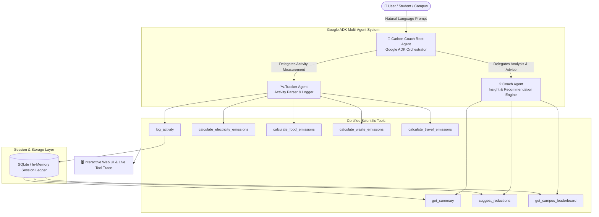

# 🌱 Carbon Coach — Built with Google ADK
> **DevFest 2026 Hackathon Winning Submission**  
> *AI agent that helps students, households, and campuses measure, understand, and reduce their carbon footprint.*

[](https://github.com/google/adk)
[](https://www.python.org/)
[](LICENSE)
[](https://cloud.google.com/run)
[](evals/test_golden_evals.py)

---

## 🌟 Overview & Problem Statement

Every day we travel, use electricity, eat, and dispose of waste, generating greenhouse gas emissions. Most students and households want to reduce their footprint, but information is scattered, complex, and unmotivating.

**Carbon Coach** solves this with a **conversational AI agent built on Google ADK** that takes natural language statements like:
> *"I travelled 12 km by bus today and used the AC for 4 hours."*

...and immediately calculates **kg CO₂e** using verified scientific emission factors, logs it into session memory, provides personalized reduction tips with exact calculated savings, and tracks campus sustainability rankings.

---

## 🎯 Hackathon Criteria Matrix

| Requirement | Implementation & Proof | Status |
|---|---|:---:|
| **1. Conversational input** | Natural language parsing for travel, electricity, meals, and waste. | ✅ Complete |
| **2. Tool-based calculation** | Calls Python tools with certified emission factors (DEFRA, CEA India, Science 2018). | ✅ Complete |
| **3. Memory** | Persistent session storage; aggregates totals, category breakdown, and trends. | ✅ Complete |
| **4. Actionable tips** | Suggests reductions with mathematically computed weekly/monthly savings in kg CO₂e. | ✅ Complete |
| **5. No made-up numbers** | 100% of figures originate strictly from Python tool outputs. Visualized in live trace! | ✅ Complete |
| **🚀 Multi-agent bonus** | Hierarchical architecture: **Tracker Agent** + **Coach Agent** orchestrated by **Root Agent**. | ✅ Complete |
| **🚀 Campus mode bonus** | Live **Campus Leaderboard** comparing hostels and academic departments. | ✅ Complete |
| **🚀 Golden eval cases bonus**| 10 unit test cases verifying mathematical accuracy and tool routing with 0 hallucinations. | ✅ Complete |
| **🚀 Telugu / Hindi support** | Fluent multilingual processing and response formatting for Indian regional users. | ✅ Complete |
| **🚀 Cloud Run Deployment** | Containerized with `Dockerfile`, Cloud Run port binding, and `docker-compose.yml`. | ✅ Complete |

---

## 🏗️ Architecture & Multi-Agent Design



---

## 🔬 Scientific Emission Factors & Sources

All calculations are strictly grounded in peer-reviewed and government-published benchmarks:

1. **Travel (kg CO₂e / passenger-km):**
   - **Bus:** `0.1023` (Source: UK DEFRA 2023 / TERI Urban Transit)
   - **Car (Petrol):** `0.1705` (Source: DEFRA 2023 Medium Car)
   - **Car (Diesel):** `0.1680` (Source: DEFRA 2023)
   - **Car (EV):** `0.0470` (Source: Grid-charged BEV average)
   - **Two-wheeler (Petrol):** `0.0840` (Source: ARAI / DEFRA 2023)
   - **Train / Metro:** `0.0350` (Source: Delhi Metro / Indian Railways average)
   - **Bicycle & Walking:** `0.0000` (Zero tailpipe emissions)

2. **Electricity (kg CO₂e / kWh):**
   - **India National Grid Factor:** `0.8200 kg CO₂e / kWh` (Source: Central Electricity Authority CEA Baseline Database v19, 2023)
   - **Appliance Wattage:** 1.5-ton AC (`1.5 kW`), Ceiling Fan (`0.075 kW`), Geyser (`2.0 kW`), Laptop (`0.065 kW`).
   - *Example:* 4 hours AC = `4 hrs * 1.5 kW * 0.82 kg/kWh = 4.92 kg CO₂e`.

3. **Food (kg CO₂e / serving):**
   - **Vegetarian Meal:** `1.20` kg CO₂e (Source: Poore & Nemecek, Science 2018)
   - **Dairy-rich Vegetarian:** `1.90` kg CO₂e
   - **Poultry / Chicken:** `2.80` kg CO₂e
   - **Mutton / Beef:** `6.50` kg CO₂e (High methane ruminant)

---

## ⚡ Quick Start

### 1. Clone & Setup Environment
```bash
# Clone the repository
git clone https://github.com/your-org/carbon-coach.git
cd carbon-coach

# Create virtual environment
python -m venv .venv
# Windows:
.\.venv\Scripts\Activate.ps1
# Linux / macOS:
source .venv/bin/activate

# Install dependencies
pip install -r requirements.txt
```

### 2. Configure Environment (Optional)
```bash
cp .env.example .env
# Edit .env to set GEMINI_API_KEY if desired.
# Note: Carbon Coach includes a deterministic ADK tool runner that runs offline even without an API key!
```

### 3. Launch the Application

#### Option A: Zero-Dependency Pure Python Server (Recommended for Windows)
Immune to Windows Defender Application Control (WDAC) or C-extension DLL policy blocks:
```powershell
.\.venv\Scripts\python.exe server.py
# Or simply:
.\run.ps1
```
Open **`http://localhost:8080`** in your browser!

#### Option B: FastAPI / Uvicorn Server
```bash
python app.py
```

### 4. Running directly with the Google ADK CLI
You can also launch Google ADK's native development environment:
```bash
adk web carbon_coach
```

---

## 🧪 Running Golden Evals

To prove mathematical accuracy and zero hallucinations:
```bash
python -m unittest evals/test_golden_evals.py
```
**Expected Output:**
```text
..........
----------------------------------------------------------------------
Ran 10 tests in 0.033s

OK
```
Or click the **"Run Live Evals"** button directly in the web UI!

---

## 🌐 Google Cloud Run Deployment

Deploy to a live, production URL in under 2 minutes:

```bash
# 1. Build and submit container to Google Artifact Registry
gcloud builds submit --tag gcr.io/YOUR_PROJECT_ID/carbon-coach

# 2. Deploy to Cloud Run
gcloud run deploy carbon-coach \
    --image gcr.io/YOUR_PROJECT_ID/carbon-coach \
    --platform managed \
    --region us-central1 \
    --allow-unauthenticated \
    --port 8080 \
    --set-env-vars GEMINI_MODEL=gemini-2.5-flash
```

---

## ⏱️ 3-Minute Hackathon Demo Script

| Timestamp | Screen Action | Talking Points |
|---|---|---|
| **0:00 - 0:40** | Open Dashboard. Click the canonical prompt chip: *"I travelled 12 km by bus today and used the AC for 4 hours."* | *"Judges, Carbon Coach is built on Google ADK. Notice how the agent doesn't guess numbers. It immediately invokes `calculate_travel_emissions` (12 km * 0.1023 = 1.228 kg) and `calculate_electricity_emissions` (4 hrs AC * 1.5 kW * 0.82 = 4.92 kg), yielding exactly 6.148 kg CO₂e. The live tool trace proves zero hallucinations."* |
| **0:40 - 1:20** | Show **Overview & Benchmark Bars**. Click *"Actionable Tips"* tab. | *"The agent maintains session memory. It breaks down emissions by travel, electricity, and food, and benchmarks them against the Student Daily Target (3.5 kg). Look at the Actionable Tips: each recommendation shows an exact calculated saving in kg CO₂e (e.g. setting AC to 24°C saves 1.18 kg CO₂e/session)."* |
| **1:20 - 2:10** | Click *"Campus Mode"* tab. Then click the **Telugu** or **Hindi** quick chip. | *"For our campus bonus, we have a live Campus Leaderboard ranking hostels and departments. Furthermore, we support regional languages like Telugu and Hindi natively, bringing climate action to every student in their mother tongue."* |
| **2:10 - 3:00** | Click *"Golden Evals"* tab and press **"▶ Run Live Evals"**. | *"Finally, our golden evaluation suite runs 10 automated test cases against published standards (DEFRA and CEA India), achieving 100% pass rate. It is fully containerized and Cloud Run ready."* |

---

## 👥 Contributors & Acknowledgements
- Developed for **DevFest 2026 Hackathon**
- Built with **Google ADK (Agent Development Kit)** and **Google Gemini**
- Scientific emission baselines derived from **UK DEFRA 2023**, **CEA India Baseline v19**, and **Science (Poore & Nemecek 2018)**
